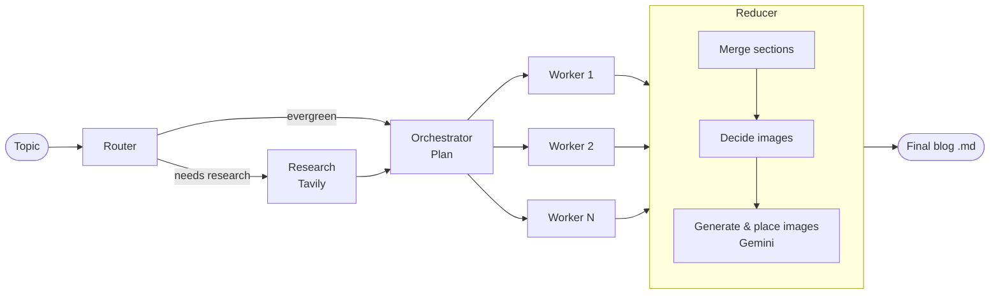

<div align="center">

# ✍️ Blog Writing Agent

**An AI agent that researches, plans, writes, and illustrates complete blog posts from a single topic.**

Built with **LangGraph**, **OpenAI**, **Tavily**, **Gemini**, and **Streamlit**.


</div>

---

## 📖 Overview

Blog Writing Agent turns a topic into a finished, Markdown-formatted blog post. It decides whether the topic needs fresh web research, gathers and filters sources, drafts a structured outline, writes every section in parallel, and adds AI-generated diagrams where they help the reader.

Everything runs through a Streamlit dashboard where you can watch the agent work step by step, inspect its plan and sources, and download the result.

## ✨ Features

- **Smart research routing** – classifies each topic as *closed-book* (evergreen), *hybrid*, or *open-book* (news/latest) and only searches the web when it's needed.
- **Grounded writing** – web results from Tavily are deduplicated, date-filtered, and cited as inline source links, so claims about recent events are backed by real URLs.
- **Structured planning** – produces a 5–9 section outline with goals, key points, word targets, and flags for research, citations, and code.
- **Parallel section writing** – each section is written by its own worker node at the same time, then merged in order.
- **AI-generated images** – picks up to 3 places where a diagram adds value and generates them with Gemini, with a graceful fallback if image generation fails.
- **Interactive dashboard** – live progress, plan and evidence tables, Markdown preview, image gallery, logs, and a history of past blogs.
- **One-click export** – download the post as Markdown or as a ZIP bundle with its images.

## 🧠 How It Works



| Stage | What it does |
|---|---|
| **Router** | Decides the research mode and writes targeted search queries. |
| **Research** | Runs Tavily searches, extracts evidence, and drops stale results for news topics. |
| **Orchestrator** | Builds the blog plan: title, audience, tone, type, and section tasks. |
| **Workers** | Write each section in parallel, following its bullets, word target, and citation rules. |
| **Reducer** | Merges sections, plans diagrams, generates images, and saves the final Markdown file. |

## 🛠️ Tech Stack

| Layer | Technology |
|---|---|
| Agent orchestration | [LangGraph](https://github.com/langchain-ai/langgraph) |
| Language model | OpenAI `gpt-4.1-mini` via LangChain |
| Web research | [Tavily Search](https://tavily.com) |
| Image generation | Google Gemini `gemini-2.5-flash-image` |
| Data validation | Pydantic |
| User interface | Streamlit |

## 🚀 Getting Started

### Prerequisites

- Python 3.10 or newer
- API keys for **OpenAI** (required), **Tavily** (optional, enables web research), and **Google Gemini** (optional, enables images)

### Installation

```bash
# 1. Clone the repository
git clone https://github.com/Bigyan-009/Blog-writing-agent.git
cd Blog-writing-agent

# 2. Create and activate a virtual environment
python -m venv .venv
# Windows
.venv\Scripts\activate
# macOS / Linux
source .venv/bin/activate

# 3. Install dependencies
pip install -r requirements.txt
```

### Configuration

Copy the example environment file and add your keys:

```bash
cp .env.example .env
```

```env
OPENAI_API_KEY=your-openai-key
TAVILY_API_KEY=your-tavily-key
GOOGLE_API_KEY=your-gemini-key
```

> Without `TAVILY_API_KEY` the agent writes from the model's own knowledge. Without `GOOGLE_API_KEY`, image slots are replaced with a note describing the intended diagram.

### Run

```bash
streamlit run bwa_frontend.py
```

Then open the URL shown in your terminal (usually http://localhost:8501).

## 💡 Usage

1. Enter a **topic** in the sidebar, for example *"How vector databases work"* or *"AI news this week"*.
2. Set the **as-of date** so the agent knows what counts as recent.
3. Click **🚀 Generate Blog** and follow the progress as each node runs.
4. Explore the results in the tabs:
   - **🧩 Plan** – the outline and section tasks
   - **🔎 Evidence** – sources found during research
   - **📝 Markdown Preview** – the finished post, with download buttons
   - **🖼️ Images** – generated diagrams and their prompts
   - **🧾 Logs** – a raw event log of the run
5. Reopen earlier posts anytime from **Past blogs** in the sidebar.

Generated posts are saved as `.md` files in the project folder, and images go to `images/`.

## 📁 Project Structure

```
Blog-writing-agent/
├── bwa_backend.py      # LangGraph agent: router, research, planner, workers, reducer
├── bwa_frontend.py     # Streamlit dashboard
├── requirements.txt    # Python dependencies
├── .env.example        # Template for API keys
└── README.md
```

## 👤 Author

**Bigyan Dahal** · [@Bigyan-009](https://github.com/Bigyan-009)
